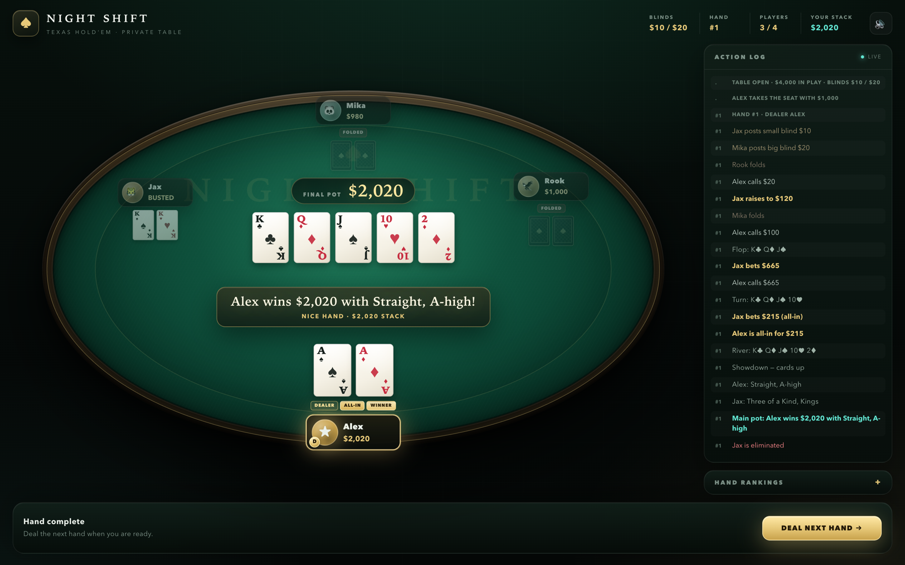

# Night Shift · Texas Hold'em

**▶ Play online: [somphol.github.io/texas-holdem-poker](https://somphol.github.io/texas-holdem-poker/)**

**Prefer 3D?** Play the [cinematic 3D edition](https://somphol.github.io/texas-holdem-3d/).

A complete no-limit Texas Hold'em tournament against up to five AI opponents — in a
single HTML file. No build step, no frameworks, no dependencies.



## Features

- **Table setup** — choose your name, starting stack, 1–5 AI opponents, and the small / big blind.
- **Full betting rounds** — pre-flop → flop → turn → river → showdown, with fold, check, call,
  raise (slider + amount field), and all-in.
- **Proper no-limit rules** — minimum raises, short all-ins, side pots, split pots, and uncalled
  bets returned through the pot tiers.
- **AI opponents** — each bot runs a Monte Carlo equity simulation, compares its equity against
  pot odds, and mixes in positional awareness, aggression, and bluffs.
- **7-card hand evaluator** — best five of seven, recognizing high card through royal flush.
- **Tournament flow** — busted players sit out; the last stack standing wins. Dedicated bust and
  "Tournament Champion!" screens, plus instant rematch.
- **Live table UI** — oval felt table, seat stacks, hole cards, dealer / SB / BB / folded / all-in
  badges, current bets, pot, community cards, winner glow, and a scrolling action log.
- **Dark casino styling** — metallic gold and cyan accents, vector-style CSS playing cards,
  responsive layout, subtle Web Audio sound effects.
- **Single file** — everything lives in `index.html`.

## Play locally

Open the file directly:

```sh
open index.html
```

Or serve the folder:

```sh
python3 -m http.server 8000
# visit http://localhost:8000
```

## Controls

| Action | Control |
| --- | --- |
| Fold | **Fold** button / `F` |
| Check / Call | **Check** / **Call** button / `C` |
| Raise | Slider + amount field, then **Raise** / `R` |
| All-In | **All-In** button / `A` |
| Deal next hand | **Deal Next Hand** / `Enter` (or `Space`) |
| Mute | Speaker button in the header |

## How it works

- **Cards** — a standard 52-card deck shuffled with Fisher–Yates. The board is dealt one street at
  a time from the same deck.
- **Hand evaluation** — every 7-card hand is evaluated by checking all 21 possible 5-card
  combinations. Each 5-card hand is scored by category plus tie-breaker ranks, which makes
  comparisons and split detection straightforward.
- **AI** — bots estimate their win probability with ~90–110 random rollouts against the number of
  live opponents, then weigh that against the pot odds. Strong hands raise for value, marginal hands
  call or fold, and a small bluff frequency keeps the table honest. Each bot has its own aggression
  profile.
- **Side pots** — player contributions are split into tiers. Each tier becomes a pot contested only
  by the players who covered it. Split pots distribute odd chips to the first winner left of the
  dealer.
- **Chip safety** — stacks, bets, and the pot are reconciled after every action, so chips are never
  created or lost.

## Project structure

```text
.
├── index.html     # the entire game (HTML + CSS + JavaScript)
├── screenshot.png # hero screenshot
├── LICENSE
└── README.md
```

## Notes

- Play money only. There is no real-money gambling, accounts, or network play.
- Bots start with the same stack as the player. Eliminate all of them to become champion.
- Tested in Chrome, Safari, Firefox, and Edge.

## License

MIT © 2026 Somphol Boonjing

Built with vanilla HTML, CSS, and JavaScript.
